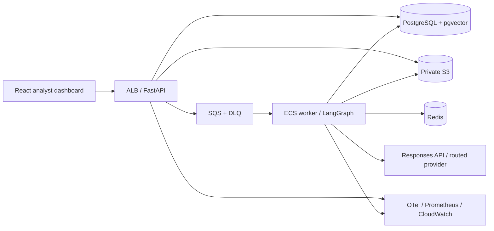
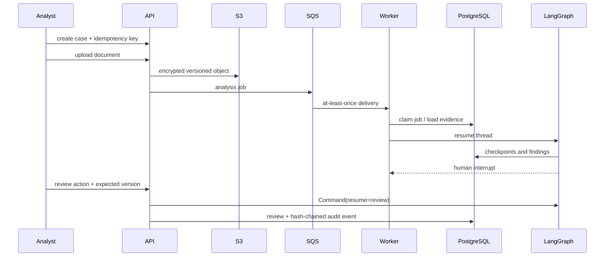

# Architecture

CreditFlow is a modular monolith deployed as separate API and worker processes. The API validates identity, tenancy, uploads, and idempotency, then enqueues work. The worker runs a durable LangGraph. Shared domain, retrieval, risk, audit, and provider modules prevent duplicate business logic.

## Request sequence

Boundaries are explicit: routes do not calculate risk; LLMs cannot execute SQL; calculations and configurable risk rules are deterministic; retrieved content is untrusted data. The local in-process runtime exercises the same contracts without cloud credentials but is not the production persistence mechanism.

## Source boundaries

- `api/v1/routes/` separates cases, documents, underwriting jobs, reviews/audit, and policies.
- `workflows/agents/` contains specialized intake, financial, risk, compliance, verification, report, and review nodes; `workflows/graph.py` only composes them.
- `retrieval/` separates models, fusion, reranking, citations, embeddings, and pipeline orchestration.
- `llm/` separates providers/routing from token budgets, cost accounting, and cache identity.
- `frontend/src/` separates analyst pages, reusable components, API access, hooks, and shared types.
