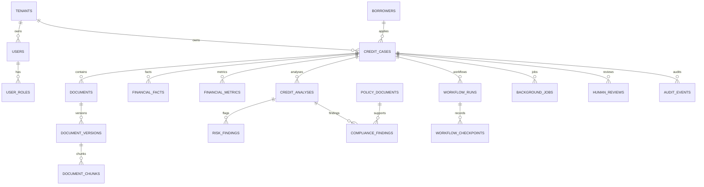

# Database

Money uses fixed-precision numeric fields and Python `Decimal`. Timestamps are UTC. Case updates use SQLAlchemy version columns. Every tenant-owned table includes/indexes `tenant_id`; RLS policies use transaction-local `app.tenant_id`. Audit mutation/revocation is denied to application roles in production grants.
